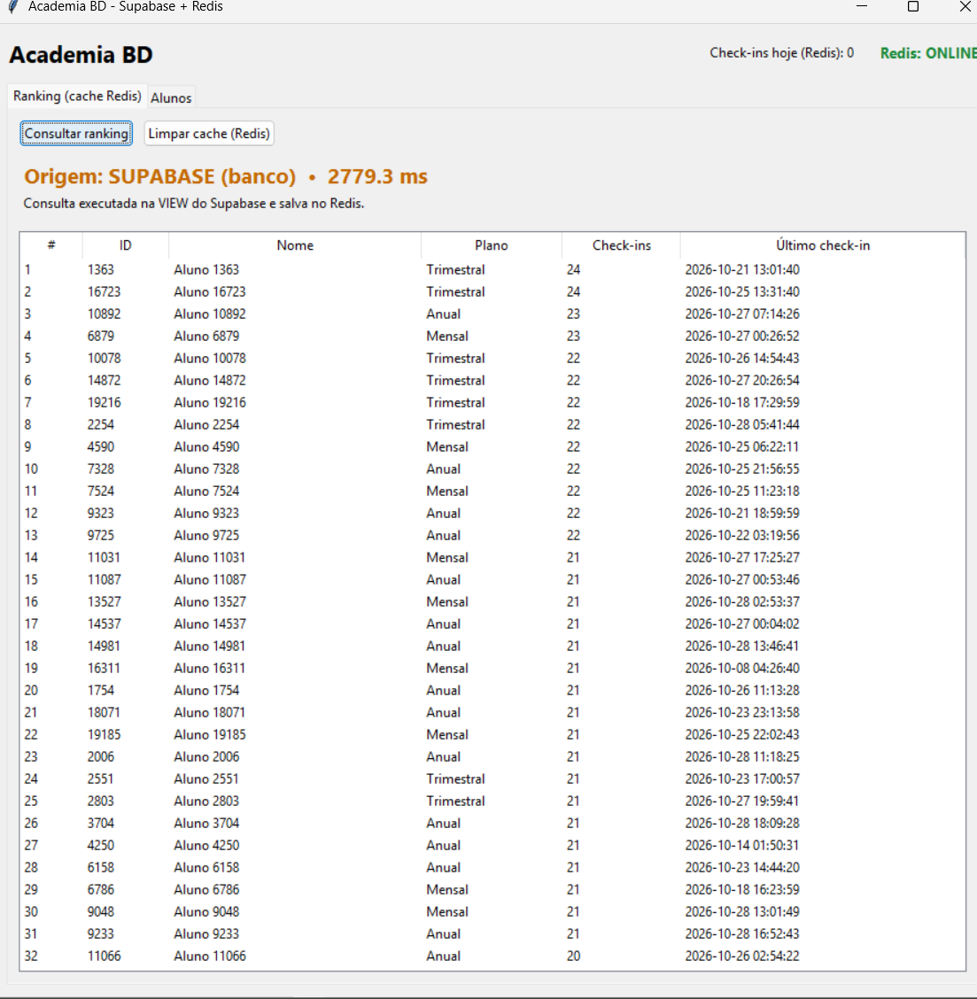
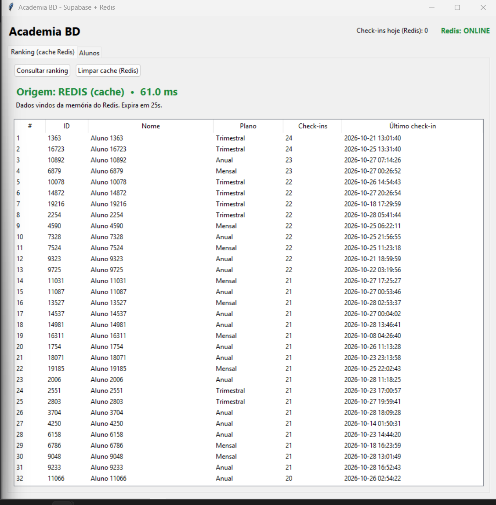
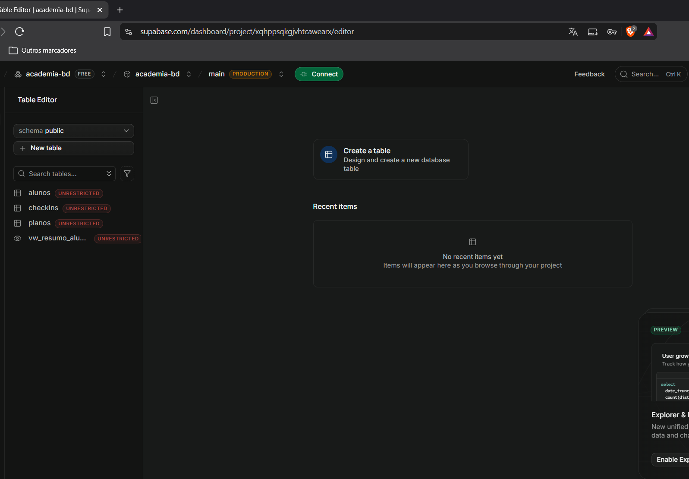

# Academia BD

Sistema de gestão de academia com **interface gráfica (Tkinter)**, banco de dados **PostgreSQL no Supabase** e **cache com Redis**.

Trabalho Prático — Integração com Supabase e Redis (UNIFSA).

## Problema que resolve

Academias precisam acompanhar alunos, planos e frequência. O ranking de frequência exige uma consulta agregada (`JOIN` + `GROUP BY` + `COUNT`) sobre centenas de milhares de check-ins, e é consultado com muita frequência. Fazer essa consulta pesada a cada acesso desperdiça tempo e carga do banco.

## Objetivo e funcionalidades

- Cadastrar, editar, buscar e excluir alunos (CRUD).
- Registrar check-ins pela **Procedure** `sp_registrar_checkin`.
- Consultar o total de check-ins de um aluno pela **Function** `fn_total_checkins`.
- Ver o **ranking de frequência** a partir da **View** `vw_resumo_alunos`, com cache no Redis.
- Mostrar na tela, a cada consulta, se o dado veio do **Redis** ou do **Supabase** e quanto tempo levou.
- Contador de check-ins do dia mantido no Redis.

## Tecnologias

Python 3 · Tkinter · PostgreSQL (Supabase) · psycopg2 · Redis (redis-py) · python-dotenv · Docker (para o Redis local)

## Instalação e execução

1. **Pré-requisitos:** Python 3.10+, Docker (ou uma conta gratuita no Upstash para o Redis) e um projeto no Supabase.
2. **Instalar dependências:**
   ```bash
   pip install -r requirements.txt
   ```
3. **Subir o Redis:**
   ```bash
   docker compose up -d
   ```
4. **Configurar o ambiente:** copie `.env.example` para `.env` e preencha `DATABASE_URL` com a connection string do **Session pooler** do Supabase (*Connect → Direct → Session pooler → URI*). O `.env` não vai para o GitHub.
5. **Criar o banco no Supabase** (tabelas, view, function, procedure e dados de teste):
   ```bash
   python src/criar_banco.py
   ```
   Use `--sem-dados` para criar apenas a estrutura. Os scripts SQL também estão em `sql/` e podem ser colados no SQL Editor do Supabase.
6. **Testar as conexões:**
   ```bash
   python src/teste_conexao.py
   ```
7. **Abrir o sistema:**
   ```bash
   python src/interface_academia.py
   ```

## Integração com o Supabase

O Supabase fornece o PostgreSQL gerenciado onde ficam todos os dados. A aplicação conecta direto ao banco com `psycopg2`, usando a connection string do Session pooler (variável `DATABASE_URL`).

| Objeto | Descrição |
|---|---|
| `planos`, `alunos`, `checkins` | Tabelas com chaves estrangeiras e `ON DELETE CASCADE` |
| `vw_resumo_alunos` | View com total de check-ins e último check-in por aluno |
| `fn_total_checkins(aluno_id)` | Function que retorna o total de check-ins |
| `sp_registrar_checkin(aluno_id)` | Procedure que valida o aluno e registra o check-in |

Os dados de teste (20 mil alunos e 200 mil check-ins) deixam a consulta da View pesada o bastante para o efeito do cache aparecer.

## Onde e como o Redis foi usado (e por quê)

**1. Cache do ranking de frequência** (`src/cache.py` e `src/sistema_academia.py`)

- **Necessidade:** o ranking vem de uma consulta agregada pesada, repetida a cada abertura da tela, e o resultado muda pouco.
- **Como funciona (padrão cache-aside):** a aplicação procura a chave `academia:ranking:50` no Redis. Se existe, devolve na hora. Se não, consulta a View no Supabase, guarda o resultado no Redis com **TTL de 60 segundos** e devolve.
- **Invalidação:** qualquer cadastro, edição, exclusão ou check-in apaga as chaves do ranking, evitando mostrar dados desatualizados.
- **Benefício medido:** na primeira consulta (Supabase) a resposta levou cerca de 2,8 s (2779 ms); a seguinte (Redis), cerca de 61 ms, e o banco deixa de ser consultado repetidamente. A tela exibe a origem e o tempo de cada consulta.

**2. Contador de check-ins do dia** (`INCR`)

- Cada check-in incrementa uma chave diária no Redis (`checkins:hoje:AAAA-MM-DD`), dando a contagem em tempo real sem consultar o banco.

**Por que Redis:** guarda dados em memória, responde em submilissegundos, tem expiração (TTL) nativa e operações atômicas como `INCR`, o que o torna ideal para cache e contadores.

**Tolerância a falhas:** se o Redis estiver fora do ar, o sistema continua funcionando consultando direto o Supabase.

## Capturas de tela

**Ranking consultado no Supabase (primeira consulta, ~2,8 s):**



**Mesmo ranking vindo do Redis (cache, ~61 ms):**



**Tabelas e view criadas no Supabase:**



## Estrutura do projeto

```
academia-bd/
├── sql/               # 01_schema.sql e 02_seed.sql
├── src/
│   ├── config.py      # leitura do .env
│   ├── db.py          # conexão com o Supabase
│   ├── cache.py       # Redis (cache-aside, contador)
│   ├── sistema_academia.py  # regras de negócio
│   ├── interface_academia.py # telas (Tkinter)
│   ├── criar_banco.py # cria o banco no Supabase
│   └── teste_conexao.py
├── docs/              # prints
├── docker-compose.yml # Redis local
├── .env.example
└── requirements.txt
```

## Aluno

João Victor da Cunha Oliveira.
